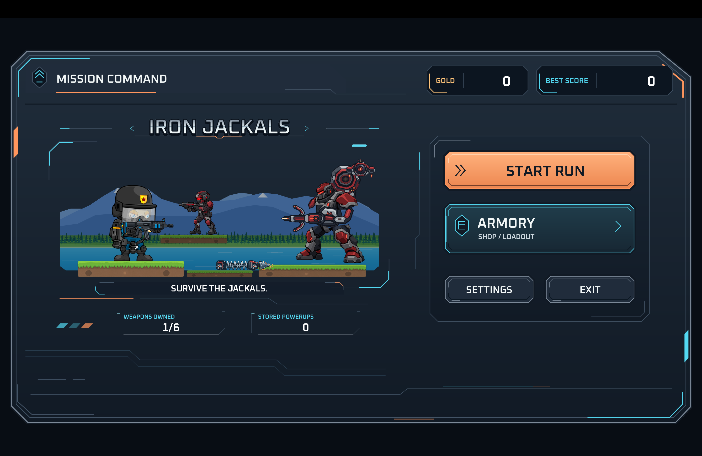
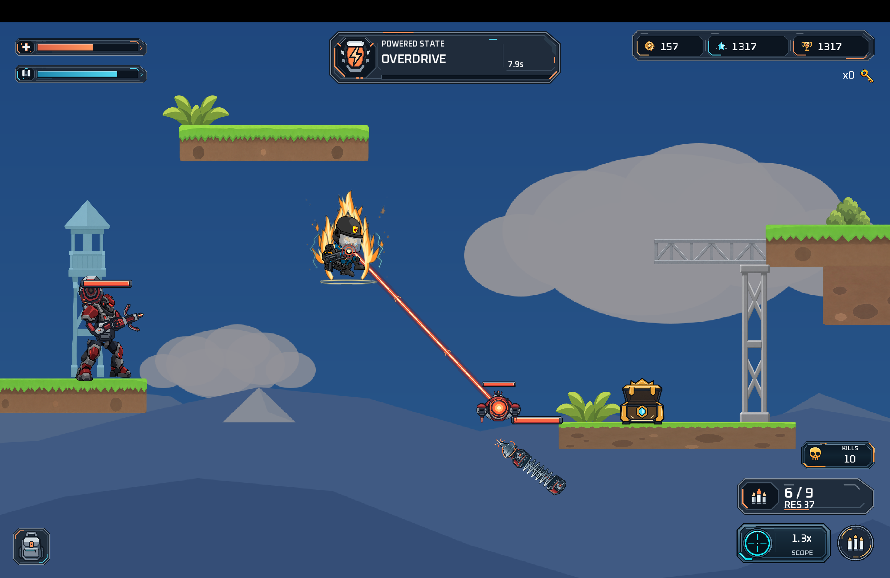
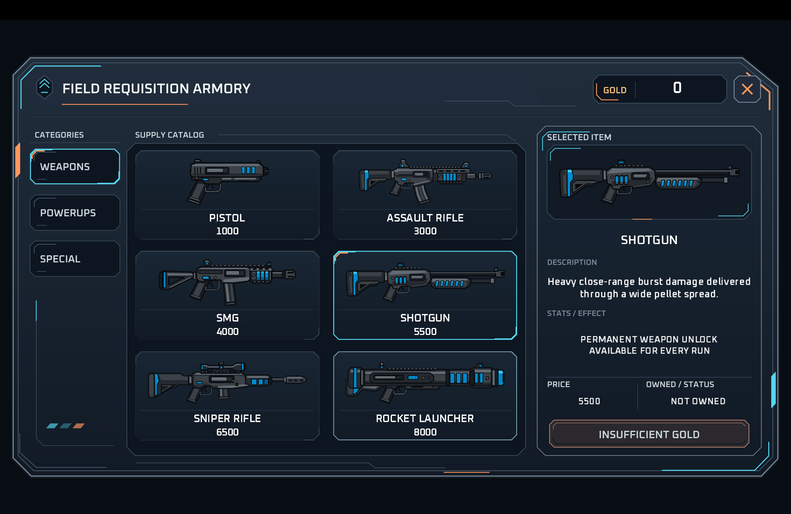

# Dropzone Iron Jackals

**Dropzone Iron Jackals** is a 2D sci-fi action platformer built in Java with LibGDX.

What started as a small game assignment grew into a much larger project with custom enemy AI, weapons, powerups, loot systems, progression, menus, save data, and a packaged macOS release.

## Download

The current playable build is available from GitHub Releases:

**[Download the latest release](https://github.com/Rojan-Mahat/Dropzone-Iron-Jackals/releases/latest)**
Current public build:
- macOS
- Apple Silicon
- packaged as a `.zip` containing `Dropzone Iron Jackals.app`

> macOS may warn that the developer cannot be verified because the app is not notarized. If that happens, right-click the app and choose **Open**.


## Screenshots

### Main Menu


### Gameplay Combat


### Field Requisition Armory



## Features

- Multiple enemy types with different behaviors and attacks
- Rifleman, Heavy, Hover Drone, and Drill Crawler enemies
- Difficulty progression from Easy to Medium, Hard, and Impossible
- Pistol, assault rifle, SMG, shotgun, sniper rifle, and rocket launcher
- Head, body, and limb damage
- Jetpack movement, crouching, aiming, reloading, and variable scope zoom
- Loot crates with multiple rarity tiers
- Special locked crates and field keys
- Temporary weapon-trial deployments
- Inventory system
- Field shop
- Permanent weapon unlocks
- Ammo economy
- Normal, Spicy, More Spicy, and God Mode powerups
- Gold, score, best score, and persistent save data
- Animated startup intro, menus, HUD, transitions, status effects, and milestone graphics
- Dynamic enemy spawning and difficulty scaling

## Enemy Types

### Rifleman
Ground enemy focused on ranged combat, scouting, line-of-sight checks, and player pursuit.

### Heavy
Tank-style siege enemy with close-range attacks and drone-assisted portal attacks.

### Hover Drone
Airborne support enemy that detects and pressures the player while assisting Heavy targeting.

### Drill Crawler
Ground enemy with alternate movement behavior and drilling-based navigation.

## Controls

| Action | Control |
| --- | --- |
| Move | A / D or Arrow Keys |
| Jump / Jetpack | W or Up Arrow |
| Crouch | C |
| Shoot | Left Mouse |
| Reload | R or Right Mouse |
| Scope | Scope HUD button |
| Open nearby crate | E |
| Claim crate reward | Q |
| Pause | Esc |

## Third-Party Assets

- Character and enemy sprites: **“Spec Ops - Game Sprites” by pzUH**, purchased through itch.io.
- Some UI artwork, icons, visual effects, and animation assets were generated with **OpenAI / ChatGPT image-generation tools**.

## Tools Used

- **Java**
- **LibGDX**
- **Tiled**
- **Krita**
- **Spriter**
- **Gradle**

## Running From Source

Clone the repository and run the desktop target:

```bash
./gradlew lwjgl3:run
```

To build the Apple Silicon macOS app bundle:

```bash
./gradlew lwjgl3:buildMacAppBundleMacM1
```

The generated app bundle is placed under:

```text
lwjgl3/build/construo/macM1/
```

## Project Notes

This project was built as a learning project and expanded far beyond its original scope. A major goal was learning how game systems work underneath the surface rather than relying on a full game engine.

Some of the systems implemented during development include:
- Tiled map design and world layout
- World-space and HUD rendering
- Camera tracking
- Enemy navigation, movement, and state logic
- Projectile collision and AABB platform collisions
- Vectors, line-of-sight checks, and angular movement
- UI scaling, rotation, and transformations
- Weapon state management
- Inventory, shop, and economy systems
- Persistent player progression
- Animated UI, audio, and visual effects

## Release

Latest release: **v1.0.0**

[View releases](https://github.com/Rojan-Mahat/Dropzone-Iron-Jackals/releases)

---

Built by **Rojan Mahat**.
